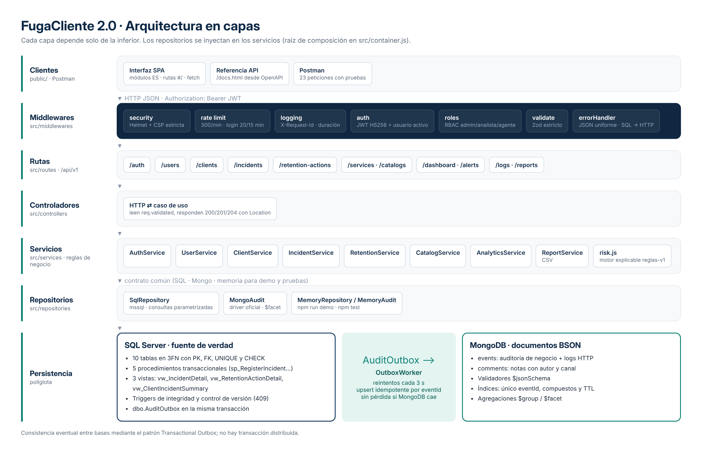

<p align="center"></p>

<h1 align="center">FugaCliente 2.0</h1>
<p align="center"><b>Detección explicable de clientes en riesgo de abandono por mal servicio</b><br>
API REST en capas con Express 5 · SQL Server · MongoDB · interfaz web sin dependencias externas</p>

---

FugaCliente reúne las incidencias de atención de cada cliente, calcula un **puntaje de riesgo de 0 a 100 que explica sus causas** y permite coordinar **acciones de retención** con responsable, fecha límite y resultado. Proyecto para la **Evaluación Parcial de Desarrollo Web Full Stack Backend**.

- **SQL Server** es la fuente de verdad: tablas normalizadas, procedimientos almacenados transaccionales, vistas, triggers e índices.
- **MongoDB** guarda la auditoría y los comentarios como documentos BSON, con validadores `$jsonSchema`, índices, TTL y agregaciones.
- El **patrón Transactional Outbox** conecta ambas bases sin perder eventos aunque MongoDB no esté disponible.



## Empezar en dos comandos

Requisitos: **Node.js 22 o 24 LTS** y una terminal abierta en esta carpeta (donde está `package.json`).

```bash
npm ci
npm run demo
```

Abre **http://localhost:3000** y entra con:

| Rol | Correo | Contraseña |
|---|---|---|
| Administrador | `admin@fugacliente.local` | `FugaCliente2026!` |
| Analista | `carla.analista@fugacliente.local` | `FugaCliente2026!` |
| Agente | `jorge.agente@fugacliente.local` | `FugaCliente2026!` |

La demo usa **memoria temporal** con 14 clientes y 30 incidencias ficticias repartidas en 8 semanas. Sirve para conocer la aplicación; **no demuestra la persistencia SQL/NoSQL de la rúbrica**. Para la evaluación usa el modo completo.

## Modo completo: SQL Server + MongoDB

Necesitas SQL Server 2022+ y MongoDB 8.0, o Docker Desktop para usar `docker-compose.yml`. SQL Server requiere un equipo x86-64; en ARM usa un servidor remoto.

1. `npm ci`
2. Copia la configuración: `Copy-Item .env.example .env` (PowerShell) o `cp .env.example .env` (macOS/Linux).
3. Mantén `DB_MODE=sqlmongo` y cambia `JWT_SECRET` por un valor aleatorio:
   ```bash
   node -e "console.log(require('node:crypto').randomBytes(48).toString('hex'))"
   ```
4. Inicia las bases (la contraseña del contenedor SQL es `SQL_PASSWORD` de `.env`):
   ```bash
   docker compose up -d --wait
   ```
5. Prepara el esquema, carga datos ficticios, diagnostica y arranca:
   ```bash
   npm run db:setup     # tablas, procedimientos, vistas, triggers, admin y colecciones MongoDB
   npm run db:seed      # datos ficticios + usuarios analista y agente
   npm run doctor       # verifica conexiones, 5 procedimientos y 3 vistas
   npm run dev
   ```
6. Abre **http://localhost:3000**. `GET /api/health` debe indicar `mode: sqlmongo`, `sql: ok` y `mongo: ok`.

Si tus bases ya existen o son remotas, omite Docker y configura `SQL_HOST`, `SQL_PORT`, `SQL_USER`, `SQL_PASSWORD`, `SQL_DATABASE`, `MONGO_URI` y `MONGO_DATABASE`. Con certificado válido usa `SQL_ENCRYPT=true` y `SQL_TRUST_CERT=false`. **Si actualizas desde la versión 1, vuelve a ejecutar `npm run db:setup`**: el script es idempotente y crea las vistas nuevas sin borrar datos.

También puedes ejecutar la aplicación en un contenedor (después de `db:setup`): `docker compose --profile app up -d --build`.

## Qué incluye

| Área | Funcionalidad |
|---|---|
| Clientes | Alta, edición, archivo lógico, búsqueda sin tildes, filtros por nivel y estado, exportación CSV |
| Riesgo | Puntaje 0–100 con 5 factores visibles, recomendación, alertas y cola de prioridad |
| Incidencias | Registro transaccional (SP), máquina de estados, control de versión (409), estado de SLA |
| Retención | Acciones con responsable y fecha, detección de vencidas, resultado inmutable, tasa de recuperación |
| Panel | KPIs, distribución, tendencia de 8 semanas, motivos, carga por servicio, factores que explican el riesgo |
| Equipo | Usuarios con roles (admin, analista, agente), habilitar/deshabilitar, edición de SLA por servicio |
| Auditoría | Eventos de negocio vía outbox, logs HTTP con `X-Request-Id`, resumen con agregación `$facet` |
| Interfaz | Modo claro/oscuro, adaptable a celular, búsqueda global (`/`), panel lateral de cliente, accesible por teclado |
| Documentación | Referencia interactiva en `/api/docs`, OpenAPI 3, Postman (23 peticiones con pruebas) |

## Arquitectura

```text
Petición HTTP
  └─ middlewares   security (Helmet/CSP) · rate limit · logging · JSON · auth JWT · roles · validate (Zod)
      └─ routes        src/routes/*.routes.js        → declaran endpoints y middlewares
          └─ controllers src/controllers/*.js        → HTTP ⇄ caso de uso (200/201/204, Location)
              └─ services   src/services/*.js        → reglas de negocio, riesgo, analítica, reportes
                  └─ repositories src/repositories   → SqlRepository · MongoAudit · Memory*
                      └─ SQL Server (SP, vistas, outbox) · MongoDB (events, comments)
```

- **Inyección de dependencias** en `src/container.js`: los servicios reciben los repositorios por constructor. La misma lógica corre con SQL+Mongo, con la demo en memoria y en las pruebas.
- **Contrato común de repositorios**: `MemoryRepository` replica las reglas de los procedimientos (estados, versiones, integridad, outbox) para probar sin bases instaladas.
- **Vocabulario de dominio único** en `src/config/constants.js` (roles, estados, transiciones), reutilizado por validación y servicios.
- **API versionada** en `/api/v1`; `/api` se conserva como alias compatible.
- **Outbox**: el cambio de negocio y su evento se confirman en la misma transacción SQL; `OutboxWorker` los entrega a MongoDB con upsert idempotente por `eventId`. No hay transacción distribuida: la auditoría es eventualmente consistente.

## Persistencia

### SQL Server (`database/schema.sql`)

- 10 tablas en tercera forma normal: catálogos (`Roles`, `ClientSegments`, `Services`, `IncidentCategories`) separados de las entidades.
- PK, FK, `UNIQUE` en correos, `CHECK` de gravedad, satisfacción, estados y coherencia de fechas de resolución.
- **5 procedimientos**: `sp_QueueEvent`, `sp_RegisterIncident`, `sp_UpdateIncidentStatus`, `sp_CreateRetentionAction`, `sp_CompleteRetentionAction` con `BEGIN TRAN`, `XACT_ABORT`, bloqueo `UPDLOCK/HOLDLOCK` y `THROW`.
- **3 vistas**: `vw_IncidentDetail` y `vw_RetentionActionDetail` (lectura del API) y `vw_ClientIncidentSummary` (reportes).
- **Triggers** que impiden vincular una acción con la incidencia de otro cliente.
- Índices de cobertura para historial por cliente, estado de incidencias, acciones pendientes y outbox.

### MongoDB (`src/repositories/mongo.js`)

- `events`: auditoría de negocio y logs HTTP con payload flexible; validador `$jsonSchema`; índices `ux_eventId` (único), `ix_entity_date`, `ix_type_date` y `ttl_occurredAt` (retención configurable).
- `comments`: notas de seguimiento con autor, canal y fecha; índice por cliente.
- `summary()`: pipeline `$match` + `$facet` con `$group`, `$dateToString`, `$avg` y `$cond`.

## Regla de detección (reglas-v1)

**El puntaje no es una probabilidad estadística ni un modelo de IA.** Prioriza la atención y explica qué señales la justifican.

| Factor | Regla | Máximo |
|---|---|---:|
| Satisfacción | Última calificación en 30 días: 1–2 suma 25; 3 suma 10 | 25 |
| Pendientes | 10 por cada incidencia abierta o en proceso, sin límite de antigüedad | 30 |
| Repetición | 10 por cada incidencia adicional en 30 días, desde la segunda | 20 |
| Gravedad | Al menos una incidencia grave (3) en 30 días | 15 |
| SLA vencido | Alguna incidencia pendiente supera el SLA de su servicio | 10 |
| **Total** | | **100** |

**Bajo** 0–39 · **Medio** 40–69 · **Alto** 70–100. Una primera incidencia grave con satisfacción 1 suma 50; al resolverla baja a 40 porque desaparece el punto por pendiente pero se conserva el historial reciente. La ventana se calcula en UTC, incluye su límite y descarta fechas futuras.

## Seguridad

- Contraseñas con **bcrypt** (costo 12, máximo 72 bytes) y comparación de tiempo constante ante correos inexistentes.
- **JWT HS256** con emisor y audiencia; en cada petición se vuelve a consultar al usuario, así que un usuario deshabilitado pierde el acceso al instante.
- **RBAC** por rol; un administrador no puede degradarse ni deshabilitarse y siempre queda uno activo.
- **CSP estricta** (sin scripts ni estilos externos o en línea), Helmet, `Cache-Control: no-store` en el API y límites de tasa (300/min; login 20 cada 15 min).
- Plantillas HTML con escape automático en la interfaz (`public/js/core/html.js`); CSV protegido contra inyección de fórmulas.
- Los logs nunca guardan contraseñas, tokens, cuerpos ni parámetros de búsqueda.

| Operación | Admin | Analista | Agente |
|---|:---:|:---:|:---:|
| Ver clientes, riesgo, casos, acciones y catálogos | ✓ | ✓ | ✓ |
| Registrar clientes, incidencias, notas y acciones | ✓ | ✓ | ✓ |
| Cambiar estado de incidencias y resultado de acciones | ✓ | ✓ | ✓ |
| Editar clientes | ✓ | ✓ | |
| Consultar auditoría y exportar CSV | ✓ | ✓ | |
| Archivar clientes, gestionar usuarios y servicios | ✓ | | |

## Estructura

```text
FugaCliente/
├─ src/
│  ├─ app.js               Fábrica de Express (sin abrir puertos: testeable)
│  ├─ server.js            Arranque, worker del outbox y apagado ordenado
│  ├─ container.js         Raíz de composición (inyección de dependencias)
│  ├─ config/              Variables de entorno (Zod) y constantes de dominio
│  ├─ middlewares/         security, logging, auth/roles, validate
│  ├─ validators/          Esquemas Zod de cada recurso
│  ├─ routes/              Un router por recurso + index (/api/v1)
│  ├─ controllers/         Adaptadores HTTP
│  ├─ services/            Casos de uso, motor de riesgo, analítica, reportes, outbox
│  ├─ repositories/        sql.js · mongo.js · memory.js
│  └─ utils/               Errores, paginación, respuestas HTTP, CSV
├─ public/
│  ├─ index.html · docs.html
│  ├─ css/                 Sistema visual (tokens, claro/oscuro, responsive)
│  ├─ js/core/             api, estado, plantillas seguras, componentes, gráficos SVG
│  ├─ js/views/            panel, clientes, incidencias, retención, equipo, auditoría
│  ├─ fonts/ · icons/      Inter (OFL) e iconos de la aplicación
├─ database/schema.sql     Esquema idempotente
├─ scripts/                setup, seed, doctor, demo, check, generación de OpenAPI/Postman
├─ tests/                  41 pruebas de comportamiento + integración real opcional
├─ docs/                   API.md, SUSTENTACION.md, VERIFICACION.md, OpenAPI, Postman, informe
├─ Dockerfile · docker-compose.yml · .github/workflows/ci.yml
```

## Probar el API

- **Referencia interactiva**: http://localhost:3000/api/docs
- **OpenAPI**: http://localhost:3000/api/openapi.json (regenerar con `npm run docs:api`)
- **Postman**: importa `docs/FugaCliente.postman_collection.json` (23 peticiones en orden; guarda token e IDs automáticamente).
- Detalle de rutas, filtros y códigos: `docs/API.md`.

## Verificación

```bash
npm run verify      # revisión de sintaxis + 41 pruebas
```

Las pruebas cubren autenticación, permisos, validación, duplicados, integridad, concurrencia, reglas de riesgo, outbox con fallos, panel, agregaciones, CSV, gestión de usuarios y servicios, versionado y CSP. Usan repositorios en memoria y **no sustituyen la prueba con bases reales**. Para ella usa bases cuyo nombre termine en `_test`:

```bash
RUN_DB_INTEGRATION=1 npm run test:integration          # macOS/Linux
$env:RUN_DB_INTEGRATION="1"; npm run test:integration   # PowerShell
```

La integración continua (`.github/workflows/ci.yml`) ejecuta la verificación con Node 22 y 24. La evidencia y sus límites están en `docs/VERIFICACION.md`.

## Problemas frecuentes

| Situación | Qué revisar |
|---|---|
| `npm` no se reconoce | Instala Node.js y abre una terminal nueva |
| PowerShell bloquea `npm.ps1` | Usa `npm.cmd ci` y `npm.cmd run demo`, o CMD |
| Puerto ocupado | Cambia `PORT` en `.env` |
| Error de conexión SQL | Docker abierto, contenedor saludable, puerto TCP y contraseña de `.env` |
| `doctor` indica que faltan vistas | Ejecuta de nuevo `npm run db:setup` (idempotente) |
| Login falla tras editar `ADMIN_PASSWORD` | Solo se aplica al crear el administrador |
| Auditoría no aparece de inmediato | Espera el intervalo del worker; revisa `outboxPending` en `/api/health` |

## Alcance y mejoras futuras

Proyecto académico con conjuntos de datos pequeños: los listados con riesgo calculan una instantánea en memoria a partir de SQL. Para miles de clientes conviene precalcular el puntaje por lotes o en consultas agregadas. Los pesos requieren validación con datos históricos antes de usarse para decisiones reales. Posibles ampliaciones: notificaciones, recuperación de contraseña, carteras por agente y un modelo estadístico entrenado.

## Referencias técnicas

- [Express · manejo de errores](https://expressjs.com/en/guide/error-handling.html)
- [Microsoft · CREATE PROCEDURE](https://learn.microsoft.com/en-us/sql/t-sql/statements/create-procedure-transact-sql) · [CREATE VIEW](https://learn.microsoft.com/en-us/sql/t-sql/statements/create-view-transact-sql)
- [node-mssql](https://github.com/tediousjs/node-mssql)
- [MongoDB · índices](https://www.mongodb.com/docs/drivers/node/current/indexes/) · [$facet](https://www.mongodb.com/docs/manual/reference/operator/aggregation/facet/)
- [Transactional Outbox](https://microservices.io/patterns/data/transactional-outbox.html)
- Documento de evaluación del curso, páginas 5-10 y 12-15.
