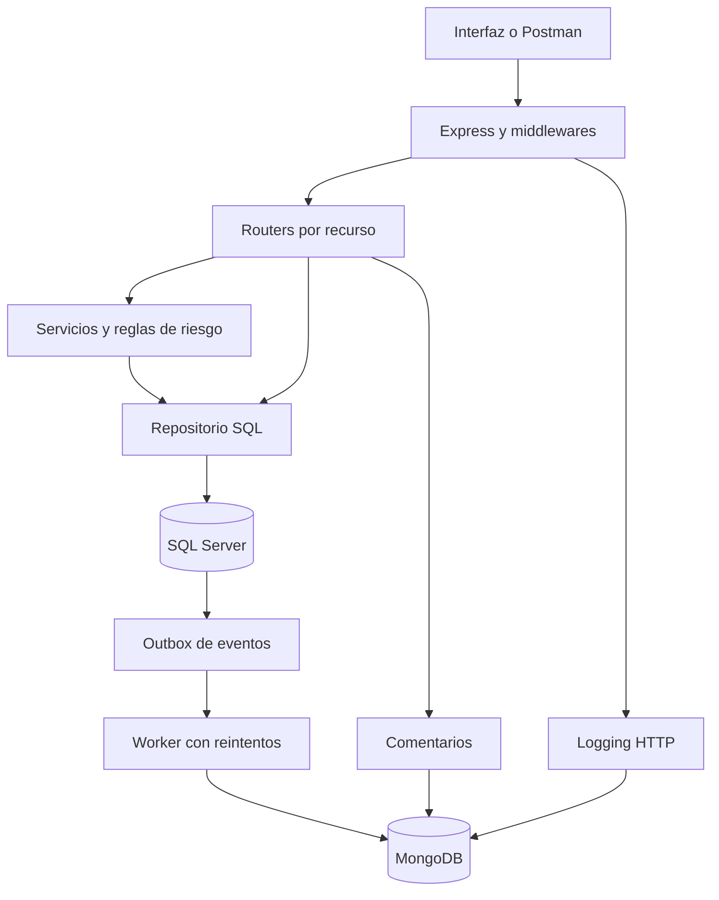

# FugaCliente

Sistema de detección de clientes en riesgo de abandonar una empresa por experiencias de mal servicio. Proyecto para la **Evaluación Parcial de Desarrollo Web Full Stack Backend**.

La aplicación permite registrar clientes, documentar incidencias, calcular un puntaje explicable de riesgo y asignar acciones de retención. **SQL Server** conserva los datos transaccionales; **MongoDB** conserva comentarios y eventos BSON. Una interfaz oscura consume el API real mediante `fetch`.

## Empezar en dos comandos

Requisitos: **Node.js 22 o 24 LTS** y una terminal abierta en esta carpeta, donde está `package.json`.

```bash
npm ci
npm run demo
```

Abre **http://localhost:3000**. Correo: `admin@fugacliente.local`. Contraseña: `FugaCliente2026!`.

Esta opción es una **demo temporal en memoria**: sirve para conocer el funcionamiento, no demuestra la persistencia SQL/NoSQL de la rúbrica. Los cambios se reinician al detener el servidor. Para la evaluación utiliza el modo completo que se explica a continuación.

## Ejecutar con SQL Server y MongoDB

Necesitas SQL Server 2022 o superior y MongoDB 8.0, o Docker Desktop con contenedores Linux para usar la configuración incluida. SQL Server necesita una máquina x86-64 compatible; si tu equipo es ARM, utiliza un servidor SQL remoto compatible. Docker debe estar abierto antes de ejecutar sus comandos.

1. Instala las dependencias con `npm ci` si todavía no lo hiciste.
2. Copia `.env.example` como `.env`.

En **PowerShell de Windows**:

```powershell
Copy-Item .env.example .env
```

En **macOS/Linux**:

```bash
cp .env.example .env
```

3. Mantén `DB_MODE=sqlmongo`. Cambia `JWT_SECRET` por un valor aleatorio. Puedes generar uno con:

```bash
node -e "console.log(require('node:crypto').randomBytes(48).toString('hex'))"
```

4. Si usas Docker, inicia las bases. `SQL_PASSWORD` de `.env` también se usa como contraseña del contenedor SQL. Los valores iniciales son para laboratorio local.

```bash
docker compose up -d --wait
```

5. Prepara el esquema, sus procedimientos, el administrador y las colecciones de MongoDB; carga ejemplos ficticios y verifica la conexión:

```bash
npm run db:setup
npm run db:seed
npm run doctor
npm run dev
```

6. Abre **http://localhost:3000**. Inicia sesión con `ADMIN_EMAIL` y `ADMIN_PASSWORD` de `.env`. `db:setup` crea el administrador si no existe y no cambia la contraseña de uno ya creado.

Si tus bases ya están instaladas o son remotas, omite el comando Docker y configura `SQL_HOST`, `SQL_PORT`, `SQL_USER`, `SQL_PASSWORD`, `SQL_DATABASE`, `MONGO_URI` y `MONGO_DATABASE`. Para SQL remoto con un certificado válido, utiliza `SQL_ENCRYPT=true` y `SQL_TRUST_CERT=false`. Si usas una instancia nombrada, define su puerto TCP explícito. La cuenta usada en `db:setup` debe poder crear la base; para la ejecución habitual usa una cuenta con permisos limitados.

`npm start` inicia sin recarga; `npm run dev` vuelve a cargar cuando cambia el código. Para detener la aplicación presiona `Ctrl+C`. `docker compose stop` detiene los contenedores y conserva sus volúmenes.

## Adaptación del caso del PDF

El PDF utiliza coworking como caso de ejemplo; el tema elegido en la imagen es **FugaCliente**. Se mantienen sus requisitos técnicos y se adaptan los recursos al negocio de atención al cliente.

| Caso de ejemplo del PDF | Aplicación en FugaCliente |
|---|---|
| Usuarios | Usuarios y roles de administrador, analista y agente |
| Salas como recurso administrable | Servicios con plazo de atención o SLA |
| Reservas como operación transaccional | Registro de incidencias de servicio |
| Stored procedure para registrar reserva | `dbo.sp_RegisterIncident` con transacción, comprobaciones y rollback |
| Logs y comentarios en MongoDB | Colecciones BSON `events` y `comments` |

## Requisitos y evidencia de implementación

| Requisito del PDF | Implementación | Archivo o prueba para mostrar |
|---|---|---|
| Entorno profesional | Variables verificadas, secretos por entorno, scripts npm y lockfile | `.env.example`, `src/config/env.js`, `package.json` |
| Express con Router | Routers separados por recurso | `src/app.js`, `src/routes/` |
| Middleware de logging | Método, ruta, estado, duración e ID de petición | `src/middlewares/logging.js` y `GET /api/logs` |
| Validación de entradas | Esquemas Zod y rechazo de campos desconocidos | `src/middlewares/validation.js` |
| Errores globales | JSON uniforme y traducción de errores SQL | `src/utils/errors.js` |
| SQL Server e integridad | PK, FK, UNIQUE, CHECK, catálogos e índices | `database/schema.sql` |
| Stored procedure | Incidencia y evento confirmados en una transacción | `dbo.sp_RegisterIncident` |
| MongoDB BSON | Eventos flexibles con campos comunes, comentarios, índices y TTL | `src/repositories/mongo.js` |
| REST Richardson nivel 2 | Recursos, verbos GET/POST/PATCH/DELETE y estados HTTP | `docs/API.md` y `docs/openapi.json` |
| Documentación | README, OpenAPI y colección de Postman con ejemplos y pruebas | `docs/` |
| Entrega comprimida | Código, SQL y `.env.example`, sin `node_modules` ni secretos | ZIP de entrega |

Los cuatro criterios de la rúbrica son arquitectura de servidor, persistencia SQL, diseño REST y persistencia NoSQL, cada uno con hasta 5 puntos. La matriz ayuda a demostrar cada criterio; la calificación depende de la ejecución y la sustentación ante el docente.

## Funciones del sistema

- Autenticación JWT y contraseñas almacenadas como hashes bcrypt.
- Gestión de clientes, búsqueda, filtros, paginación y archivo lógico.
- Registro de incidencias con servicio, categoría, gravedad, satisfacción y responsable.
- Transiciones de estado con control de versión para evitar que una actualización sobrescriba otra.
- Puntaje de riesgo de 0 a 100 con sus causas visibles.
- Alertas de riesgo medio o alto y resumen de clientes prioritarios.
- Acciones de retención con responsable, fecha futura y resultado.
- Comentarios con autor, fecha y canal guardados en MongoDB.
- Auditoría de eventos de negocio y de peticiones HTTP.
- Interfaz adaptable a computadoras y celulares, sin servicios externos de diseño.

## Regla de detección

El sistema usa reglas de negocio propuestas para este proyecto. **El puntaje no es una probabilidad estadística de abandono ni un modelo de IA entrenado.** Su objetivo es priorizar la atención y explicar qué señales justifican esa prioridad.

| Factor | Regla | Máximo |
|---|---|---:|
| Satisfacción | Última calificación en 30 días: 1 o 2 suma 25; 3 suma 10; 4 o 5 suma 0 | 25 |
| Pendientes | Cada incidencia abierta o en proceso suma 10, sin límite de antigüedad | 30 |
| Repetición | Desde la segunda incidencia en 30 días, cada adicional suma 10 | 20 |
| Gravedad | Al menos una incidencia de gravedad 3 en 30 días suma 15 | 15 |
| SLA vencido | Al menos una incidencia pendiente supera las horas del servicio | 10 |
| **Total** | Suma de factores con topes individuales | **100** |

**Bajo:** 0-39. **Medio:** 40-69. **Alto:** 70-100. Una sola incidencia reciente grave con satisfacción 1 y sin SLA vencido suma 50; si se resuelve baja a 40. Su historial reciente conserva el efecto de gravedad y satisfacción. Registrar una acción como “recuperado” documenta un resultado, pero no altera artificialmente el puntaje.

La ventana se calcula en UTC e incluye su límite exacto de 30 días. Incidencias fechadas en el futuro no se consideran. La fecha se asigna en el servidor; el API público no permite que el cliente envíe una fecha de creación arbitraria.

## Arquitectura



SQL Server es la fuente de los datos de negocio. Roles, segmentos, servicios y categorías evitan repetir descripciones en usuarios, clientes e incidencias. Las relaciones utilizan claves foráneas y los datos inválidos se rechazan tanto en el API como en SQL.

Los eventos de las operaciones SQL se guardan en `AuditOutbox` dentro de la misma transacción. Un worker los envía a MongoDB y marca los ya confirmados. MongoDB tiene un índice único por `eventId`, de modo que un reintento no duplica un evento. Esto evita perder el evento de negocio si MongoDB cae después de confirmar una incidencia. **No existe una transacción distribuida entre SQL Server y MongoDB**; la auditoría de negocio llega de manera eventual.

Los logs HTTP son observabilidad de mejor esfuerzo: una falla al guardarlos se reporta en la terminal y no cancela una operación ya confirmada. Los comentarios se guardan directamente en MongoDB; si esa base no responde, no se puede crear el comentario. La auditoría secundaria del comentario es de mejor esfuerzo. Los logs omiten contraseñas, tokens, cuerpos de las peticiones y parámetros de búsqueda.

## Permisos

| Operación | Administrador | Analista | Agente |
|---|:---:|:---:|:---:|
| Ver clientes, riesgo, casos, acciones y catálogos | Sí | Sí | Sí |
| Registrar clientes, incidencias, comentarios y acciones | Sí | Sí | Sí |
| Actualizar estado de incidencias y resultado de acciones | Sí | Sí | Sí |
| Editar datos de clientes | Sí | Sí | No |
| Archivar con DELETE | Sí | No | No |
| Consultar auditoría | Sí | Sí | No |
| Crear usuarios y servicios | Sí | No | No |

La sesión expira según `JWT_EXPIRES_IN`. El servidor comprueba la existencia, actividad y rol del usuario en cada petición. El navegador guarda el token en `sessionStorage` y lo elimina al cerrar sesión. La interfaz escapa los textos de clientes y comentarios antes de insertarlos en HTML.

## Estructura

```text
FugaCliente/
  src/app.js                  Aplicación Express
  src/server.js               Inicio y cierre del servidor
  src/config/                 Entorno y conexiones
  src/routes/                 Recursos del API
  src/middlewares/             Sesión, roles, logging y validación
  src/repositories/           SQL Server, MongoDB y demo temporal
  src/services/               Riesgo, indicadores y outbox
  database/schema.sql         Tablas, catálogos y procedimientos
  public/                     Interfaz HTML, CSS y JavaScript
  scripts/                    Preparación, carga de datos y diagnóstico
  tests/                      Pruebas de comportamiento
  docs/                       API, Postman, informe y sustentación
```

## Probar el API

Importa `docs/FugaCliente.postman_collection.json` en Postman. La colección tiene 20 peticiones ordenadas. Ejecuta login y catálogos primero; guardan automáticamente el token y los IDs. Si cambiaste los datos del administrador, modifica las variables `email` y `password` de la colección. Los ejemplos crean únicamente datos ficticios.

La especificación OpenAPI está en `docs/openapi.json` y se sirve en **http://localhost:3000/api/openapi.json**. Todos los recursos de negocio requieren el encabezado `Authorization: Bearer TOKEN`. La documentación detallada está en `docs/API.md`.

## Verificación

```bash
npm run check
npm test
```

`npm test` usa un repositorio temporal para comprobar lógica y contratos HTTP sin exigir bases instaladas. Incluye autenticación, permisos, entradas inválidas, duplicados, integridad de relaciones, concurrencia, reglas de riesgo y reintentos de auditoría. **No sustituye las pruebas con SQL Server y MongoDB reales.**

Para una prueba real, configura bases aisladas cuyos nombres terminen en `_test`, ejecuta `npm run db:setup` contra ellas y después habilita la integración:

PowerShell:

```powershell
$env:RUN_DB_INTEGRATION="1"
npm run test:integration
Remove-Item Env:RUN_DB_INTEGRATION
```

macOS/Linux:

```bash
RUN_DB_INTEGRATION=1 npm run test:integration
```

La integración crea registros identificables en esas bases de prueba y no elimina bases ni datos ajenos. Si no se habilita la variable, la prueba se omite. Antes de sustentar, vuelve a configurar las bases del proyecto y verifica que `/api/health` indique `mode: sqlmongo`, `sql: ok` y `mongo: ok`.

La evidencia de verificaciones realizadas al preparar esta entrega y sus límites se detalla en `docs/VERIFICACION.md`.

## Sustentación y documentos

- `docs/SUSTENTACION.md`: recorrido de demostración, archivos que debes abrir y respuestas a las preguntas de reflexión del PDF.
- `docs/API.md`: métodos, rutas, cuerpos y códigos HTTP.
- `docs/VERIFICACION.md`: evidencia de pruebas y revisión.
- `docs/Informe_FugaCliente.docx`: informe editable con problema, objetivos, requisitos, modelo de datos y explicación técnica.
- `LEEME_PRIMERO.txt`: pasos breves para abrir el proyecto.

## Problemas frecuentes

| Situación | Qué revisar |
|---|---|
| `npm` no se reconoce | Instala Node.js y abre una terminal nueva |
| PowerShell bloquea `npm.ps1` | Ejecuta `npm.cmd ci` y `npm.cmd run demo`, o usa CMD |
| No aparece `package.json` | Abre la terminal dentro de la carpeta FugaCliente extraída |
| Puerto ocupado | Cierra otro servidor o cambia `PORT` en `.env`; abre la nueva URL |
| Error de conexión SQL | Docker abierto, contenedor saludable, puerto TCP y contraseña de `.env` |
| Fallo de contraseña en contenedor existente | La contraseña debe coincidir con la que inicializó su volumen; no cambia solo por editar `.env` |
| Login falla tras editar `ADMIN_PASSWORD` | Ese valor se aplica solo al crear el administrador; usa la contraseña con la que se creó |
| MongoDB no conecta | Revisa `MONGO_URI`, la red permitida y las credenciales si usas Atlas |
| Auditoría no aparece de inmediato | Espera el intervalo del worker y revisa `outboxPending` en salud |
| Cambiaste `.env` con el servidor abierto | Detén con Ctrl+C y vuelve a iniciar |
| OpenAPI no abre | Comprueba que se incluyó `docs/openapi.json` y que el servidor está iniciado |

## Alcance y mejoras futuras

Esta versión cubre un laboratorio académico y conjuntos de datos pequeños. Los listados con riesgo calculan una instantánea en memoria a partir de SQL; para miles de clientes conviene llevar las agregaciones a consultas paginadas o a un proceso por lotes, y medir el rendimiento. El outbox procesado necesita una política de limpieza si se usa durante largos periodos.

Los pesos y umbrales requieren validación con datos históricos antes de usarse para decisiones comerciales reales. Otras ampliaciones posibles son notificaciones externas, recuperación de contraseña, asignación de permisos por cartera y un modelo entrenado. No se envían mensajes, correos ni compensaciones reales desde esta versión.

## Referencias técnicas

- [Express · manejo de errores](https://expressjs.com/en/guide/error-handling.html).
- [Microsoft · CREATE PROCEDURE](https://learn.microsoft.com/en-us/sql/t-sql/statements/create-procedure-transact-sql).
- [node-mssql · documentación del cliente oficial del proyecto](https://github.com/tediousjs/node-mssql).
- [MongoDB · índices en el driver de Node.js](https://www.mongodb.com/docs/drivers/node/current/indexes/).
- Documento de evaluación proporcionado por el curso, páginas 5-10 y 12-15.
